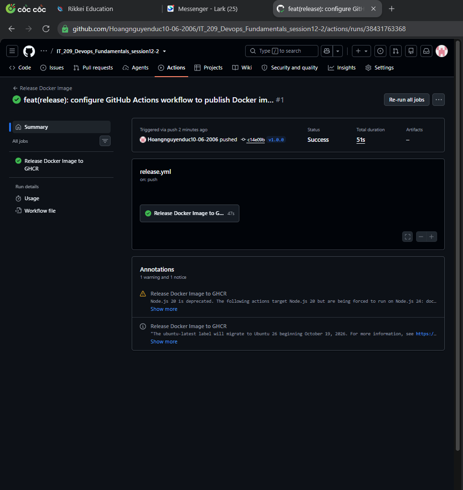

# BÁO CÁO THỰC HÀNH CI/CD: TỰ ĐỘNG ĐÓNG GÓI VÀ PHÁT HÀNH DOCKER IMAGE LÊN GITHUB PACKAGES (GHCR) THEO GIT TAG


> **Môn học:** IT-209 – DevOps Fundamentals  
> **Bài thực hành:** Session 12 – Bài 2 (Exercise 2)  
> **Đường dẫn nộp bài:** `homework/session_12/ex2/`  
> **Mục tiêu:** Cấu hình GitHub Actions tự động kích hoạt khi có sự kiện đẩy Git Tag (Semantic Versioning `v*.*.*`), build Docker Image và publish lên GitHub Container Registry (`ghcr.io`).

---

## 1. Yêu cầu đề bài

1. Tạo tệp `.github/workflows/release.yml`.
2. Khai báo sự kiện kích hoạt `on.push.tags: ['v*.*.*']`.
3. Cấu hình Job `release-image`:
   - Checkout code với `actions/checkout@v5`.
   - Đăng nhập GHCR bằng `docker/login-action@v3`.
   - Sử dụng `docker/metadata-action@v5` để trích xuất tag từ Git.
   - Đóng gói và push Docker Image bằng `docker/build-push-action@v5` đẩy lên `ghcr.io`.
4. Kiểm tra:
   - Thực thi lệnh gán tag local và đẩy lên GitHub: `git tag v1.0.0 && git push origin v1.0.0`.
   - Kiểm tra tab **Actions**: Workflow `release.yml` được kích hoạt và xuất hiện gói Image `ghcr.io/...:v1.0.0` trong mục **GitHub Packages**.
5. Sản phẩm nộp bài:
   - Tệp `.github/workflows/release.yml` (hoặc bản sao tại `homework/session_12/ex2/release.yml`).
   - Ảnh chụp màn hình gói Docker Image `v1.0.0` trên GitHub Packages.

---

## 2. Kịch bản Workflow hoàn chỉnh (`.github/workflows/release.yml`)

```yaml
name: Release Docker Image

on:
  push:
    tags:
      - 'v*.*.*'

jobs:
  release-image:
    name: Release Docker Image to GHCR
    runs-on: ubuntu-latest
    permissions:
      contents: read
      packages: write

    steps:
      - name: Checkout code
        uses: actions/checkout@v5

      - name: Log in to GitHub Container Registry
        uses: docker/login-action@v3
        with:
          registry: ghcr.io
          username: ${{ github.actor }}
          password: ${{ secrets.GITHUB_TOKEN }}

      - name: Extract Docker metadata
        id: meta
        uses: docker/metadata-action@v5
        with:
          images: ghcr.io/${{ github.repository }}
          tags: |
            type=ref,event=tag
            type=semver,pattern={{version}}

      - name: Build and push Docker Image
        uses: docker/build-push-action@v5
        with:
          context: .
          push: true
          tags: ${{ steps.meta.outputs.tags }}
          labels: ${{ steps.meta.outputs.labels }}
```

---

## 3. Giải thích chi tiết các thành phần trong Workflow

| Thành phần / Chỉ lệnh | Ý nghĩa và cơ chế hoạt động |
| :--- | :--- |
| `on.push.tags: ['v*.*.*']` | Bộ lọc sự kiện (Event Filter). Workflow chỉ chạy khi có một Git Tag mới được push khớp với pattern Semantic Versioning (ví dụ: `v1.0.0`, `v1.2.3`). Không chạy với các commit thông thường vào nhánh. |
| `permissions: packages: write` | Cấp quyền ghi (`write`) vào GitHub Packages/GHCR cho `GITHUB_TOKEN`. Nếu thiếu quyền này, action sẽ báo lỗi `403 Forbidden` khi đẩy image. |
| `actions/checkout@v5` | Sao chép toàn bộ mã nguồn của repository tại phiên bản commit gắn tag về runner. |
| `docker/login-action@v3` | Tự động xác thực tài khoản với GitHub Container Registry (`ghcr.io`) bằng biến có sẵn `${{ github.actor }}` và `${{ secrets.GITHUB_TOKEN }}` mà không cần tạo Personal Access Token thủ công. |
| `docker/metadata-action@v5` | Tự động phân tích Git tag (ví dụ: `v1.0.0`) và tạo ra các image tag tương ứng (ví dụ: `ghcr.io/<owner>/<repo>:v1.0.0` và `ghcr.io/<owner>/<repo>:1.0.0`) cùng các OCI Labels chuẩn hóa. |
| `docker/build-push-action@v5` | Sử dụng Docker Buildx để build Docker Image từ `Dockerfile` và đẩy trực tiếp lên `ghcr.io` với các tag và label đã trích xuất từ bước `meta`. |

---

## 4. Cấu hình Dockerfile (`Dockerfile`)

Để bước build Docker Image hoàn thành thành công, dự án sử dụng tệp `Dockerfile` Multi-Stage tối ưu:

```dockerfile
# Stage 1: Build JAR package
FROM eclipse-temurin:17-jdk-alpine AS builder
WORKDIR /app
COPY gradlew .
COPY gradle gradle
COPY build.gradle settings.gradle ./
RUN chmod +x gradlew
COPY src src
RUN ./gradlew bootJar -x test --no-daemon

# Stage 2: Minimal runtime image
FROM eclipse-temurin:17-jre-alpine
WORKDIR /app
COPY --from=builder /app/build/libs/*.jar app.jar
EXPOSE 8080
ENTRYPOINT ["java", "-jar", "app.jar"]
```

---

## 5. Hướng dẫn thực hành và kiểm tra kết quả

### Bước 1: Lưu cấu hình và đẩy mã nguồn lên nhánh chính (`main`)
```bash
git add .
git commit -m "feat: setup release workflow and dockerfile for ghcr"
git push origin main
```

> **Lưu ý quan trọng về quyền GitHub Actions:**  
> Trên repository GitHub, truy cập **Settings** $\rightarrow$ **Actions** $\rightarrow$ **General** $\rightarrow$ tại mục **Workflow permissions**, chọn **Read and write permissions** $\rightarrow$ nhấn **Save**.

### Bước 2: Tạo Git Tag phiên bản và đẩy lên GitHub
Thực thi lệnh theo đúng yêu cầu đề bài:
```bash
git tag v1.0.0
git push origin v1.0.0
```

### Bước 3: Kiểm tra Workflow trên GitHub Actions
1. Vào tab **Actions** trên repository.
2. Thấy workflow **Release Docker Image** tự động được kích hoạt bởi sự kiện tag `v1.0.0`.
3. Nhấp vào job **release-image** để theo dõi từng bước:
   - `Checkout code`: Thành công.
   - `Log in to GitHub Container Registry`: Thành công.
   - `Extract Docker metadata`: Trích xuất tag `ghcr.io/...:v1.0.0`.
   - `Build and push Docker Image`: Build và đẩy lên GHCR thành công.

### Bước 4: Kiểm tra GitHub Packages
1. Quay lại trang chủ của repository (hoặc Profile cá nhân).
2. Ở cột bên phải của Repository, tìm mục **Packages**.
3. Xác nhận xuất hiện gói Docker Image:
   `ghcr.io/<owner>/<repo>:v1.0.0`
4. Chụp ảnh màn hình lưu vào thư mục này để hoàn tất bài nộp.

---


