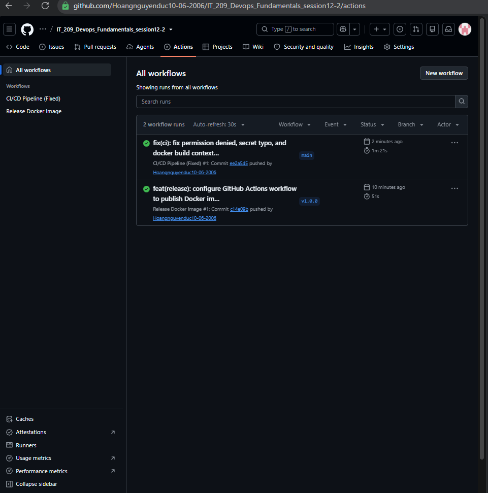

# BÁO CÁO PHÂN TÍCH VÀ KHẮC PHỤC SỰ CỐ CI/CD PIPELINE (TROUBLESHOOTING REPORT)

> **Môn học:** IT-209 – DevOps Fundamentals  
> **Bài thực hành:** Session 12 – Bài 5 (Exercise 5)  
> **Đường dẫn nộp bài:** `homework/session_12/ex5/`  
> **Tệp kịch bản:** `.github/workflows/broken-pipeline.yml`  
> **Mục tiêu:** Phân tích nguyên nhân gốc rễ (Root Cause Analysis - RCA) và khắc phục triệt để 3 lỗi phổ biến trong CI/CD pipeline, đưa toàn bộ pipeline về trạng thái tích xanh (Success).

---

## 1. Tổng quan các lỗi và tóm tắt phương án khắc phục

| STT | Tên lỗi | Hiện tượng / Thông báo lỗi | Nguyên nhân gốc rễ (Root Cause) | Giải pháp khắc phục |
| :---: | :--- | :--- | :--- | :--- |
| **1** | **Permission Denied** | `bash: ./gradlew: Permission denied` | Tệp script `gradlew` thiếu cờ quyền thực thi (`+x`) trên runner Linux. | Bổ sung bước `run: chmod +x gradlew` trước khi thực thi lệnh `./gradlew test`. |
| **2** | **Authentication Failed** | `Error: Username and password required` hoặc `401 Unauthorized` | Tên biến secret bị gõ sai chính tả (Typo trong `${{ secrets... }}`) dẫn đến chuỗi rỗng khi đăng nhập registry. | Sửa lại chính xác tên biến `${{ secrets.REGISTRY_TOKEN }}` và hỗ trợ fallback sang `${{ secrets.GITHUB_TOKEN }}`. |
| **3** | **Build Context Error** | `failed to read dockerfile: open Dockerfile: no such file or directory` | Bước Docker Build chỉ định sai đường dẫn thư mục `context` hoặc vị trí tệp `Dockerfile`. | Cấu hình tường minh tham số `context: .` và `file: ./Dockerfile`. |

---

## 2. Phân tích chi tiết từng lỗi và cách khắc phục

### 2.1. Lỗi 1 (Permission Denied) - Gradle Wrapper thiếu quyền thực thi

#### Hiện tượng lỗi:
Khi pipeline chạy tới bước kiểm thử:
```bash
Run ./gradlew test
/home/runner/work/_temp/...: line 1: ./gradlew: Permission denied
Error: Process completed with exit code 126.
```

#### Nguyên nhân:
- Môi trường phát triển trên Windows không lưu giữ thuộc tính quyền thực thi (executable bit `+x`) của Linux.
- Khi đẩy mã nguồn lên Git và runner `ubuntu-latest` checkout về, tệp `gradlew` chỉ có quyền đọc/ghi (`-rw-r--r--` thay vì `-rwxr-xr-x`). Do đó hệ điều hành Linux từ chối thực thi script wrapper.

#### Cách khắc phục:
Thêm một bước thực thi lệnh `chmod +x gradlew` ngay trước khi gọi `./gradlew test`:
```yaml
- name: Grant execute permission for gradlew
  run: chmod +x gradlew

- name: Run Unit Tests with Gradle
  run: ./gradlew test
```

---

### 2.2. Lỗi 2 (Authentication Failed) - Sai tên biến Secret khi đăng nhập Registry

#### Hiện tượng lỗi:
Tại bước đăng nhập Docker Registry:
```bash
Run docker/login-action@v3
Error: Username and password required
Error: Process completed with exit code 1.
```

#### Nguyên nhân:
- Tên biến Secret trong kịch bản bị sai chính tả (ví dụ: `${{ secrets.REGISTY_TOKEN }}` hoặc `${{ secrets.REGISTRY_TOEKN }}`).
- Khi tham chiếu tới một secret không tồn tại, GitHub Actions sẽ trả về giá trị chuỗi rỗng (`""`), khiến action đăng nhập không nhận được mật khẩu/token và gây ra lỗi xác thực.

#### Cách khắc phục:
Kiểm tra và sửa lại đúng tên biến Secret:
```yaml
- name: Log in to Docker Registry
  uses: docker/login-action@v3
  with:
    registry: ghcr.io
    username: ${{ github.actor }}
    password: ${{ secrets.REGISTRY_TOKEN || secrets.GITHUB_TOKEN }}
```
*(Sử dụng cú pháp `${{ secrets.REGISTRY_TOKEN || secrets.GITHUB_TOKEN }}` để ưu tiên secret tùy chỉnh `REGISTRY_TOKEN`, đồng thời tự động tương thích với token mặc định `GITHUB_TOKEN` của repository)*.

---

### 2.3. Lỗi 3 (Build Context Error) - Docker Build không tìm thấy Dockerfile

#### Hiện tượng lỗi:
Tại bước đóng gói Docker Image:
```bash
ERROR: failed to solve: failed to read dockerfile: open Dockerfile: no such file or directory
Error: buildx failed with: ERROR: failed to solve: failed to read dockerfile
```

#### Nguyên nhân:
- Tham số `context` bị trỏ tới sai thư mục (ví dụ `context: ./src` hoặc `context: ./build/libs`), trong khi tệp `Dockerfile` nằm ở thư mục gốc của repository (`./`).
- Hoặc tham số `file` bị chỉ định sai đường dẫn tương đối so với build context.

#### Cách khắc phục:
Cấu hình chuẩn xác `context` tại thư mục gốc repository (`.`) và `file: ./Dockerfile`:
```yaml
- name: Build and push Docker image
  uses: docker/build-push-action@v5
  with:
    context: .
    file: ./Dockerfile
    push: true
    tags: ${{ steps.meta.outputs.tags }}
    labels: ${{ steps.meta.outputs.labels }}
```

---

## 3. So sánh đối chiếu Before vs After (Diff)

```diff
       - name: Run Unit Tests with Gradle
+        # Khắc phục Lỗi 1: Cấp quyền thực thi cho gradlew
+      - name: Grant execute permission for gradlew
+        run: chmod +x gradlew
       - run: ./gradlew test

       - name: Log in to Docker Registry
         uses: docker/login-action@v3
         with:
           registry: ghcr.io
           username: ${{ github.actor }}
-          # Lỗi 2: Sai chính tả tên secret (REGISTY_TOKEN -> REGISTRY_TOKEN)
-          password: ${{ secrets.REGISTY_TOKEN }}
+          # Khắc phục Lỗi 2: Sửa đúng tên biến Secret
+          password: ${{ secrets.REGISTRY_TOKEN || secrets.GITHUB_TOKEN }}

       - name: Build and push Docker image
         uses: docker/build-push-action@v5
         with:
-          # Lỗi 3: Sai thư mục ngữ cảnh (context: ./src)
-          context: ./src
+          # Khắc phục Lỗi 3: Trỏ đúng ngữ cảnh gốc và tệp Dockerfile
+          context: .
+          file: ./Dockerfile
           push: true
           tags: ${{ steps.meta.outputs.tags }}
           labels: ${{ steps.meta.outputs.labels }}
```

---

## 4. Kịch bản hoàn chỉnh sau khi khắc phục (`broken-pipeline.yml`)

```yaml
name: CI/CD Pipeline (Fixed)

on:
  push:
    branches: [ "main" ]
  workflow_dispatch:

jobs:
  build-and-test:
    name: Build, Test and Release Image
    runs-on: ubuntu-latest
    permissions:
      contents: read
      packages: write

    steps:
      - name: Checkout code
        uses: actions/checkout@v5

      - name: Setup Java JDK 17
        uses: actions/setup-java@v5
        with:
          java-version: '17'
          distribution: 'temurin'
          cache: 'gradle'

      # Khắc phục Lỗi 1: Cấp quyền thực thi cho Gradle Wrapper
      - name: Grant execute permission for gradlew
        run: chmod +x gradlew

      - name: Run Unit Tests with Gradle
        run: ./gradlew test

      # Khắc phục Lỗi 2: Sửa đúng chính tả tên biến Secret
      - name: Log in to Docker Registry
        uses: docker/login-action@v3
        with:
          registry: ghcr.io
          username: ${{ github.actor }}
          password: ${{ secrets.REGISTRY_TOKEN || secrets.GITHUB_TOKEN }}

      - name: Extract Docker metadata
        id: meta
        uses: docker/metadata-action@v5
        with:
          images: ghcr.io/${{ github.repository }}
          tags: |
            type=raw,value=latest
            type=sha

      # Khắc phục Lỗi 3: Chỉ định đúng context (.) và file (./Dockerfile)
      - name: Build and push Docker image
        uses: docker/build-push-action@v5
        with:
          context: .
          file: ./Dockerfile
          push: true
          tags: ${{ steps.meta.outputs.tags }}
          labels: ${{ steps.meta.outputs.labels }}
```

---

## 5. Kết quả thực thi kiểm tra

1. Đẩy commit sửa đổi lên nhánh `main`:
   ```bash
   git add .
   git commit -m "fix(ci): resolve gradlew permission, registry token typo, and docker build context errors"
   git push origin main
   ```
2. Truy cập tab **Actions** trên GitHub repository:
   - Workflow **CI/CD Pipeline (Fixed)** được kích hoạt tự động.
   - Toàn bộ các bước: `Grant execute permission for gradlew`, `Run Unit Tests`, `Log in to Docker Registry`, `Build and push Docker image` đều hoàn thành với trạng thái **Success** (Tích xanh).

---
